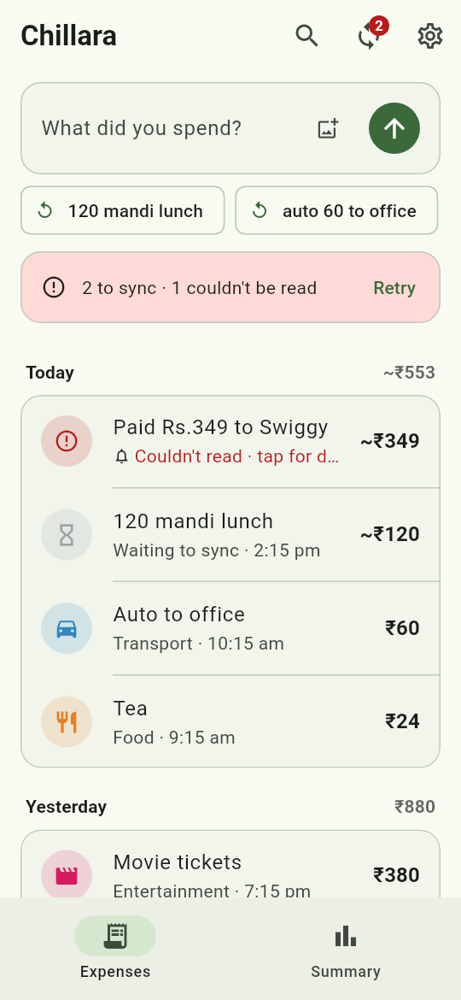
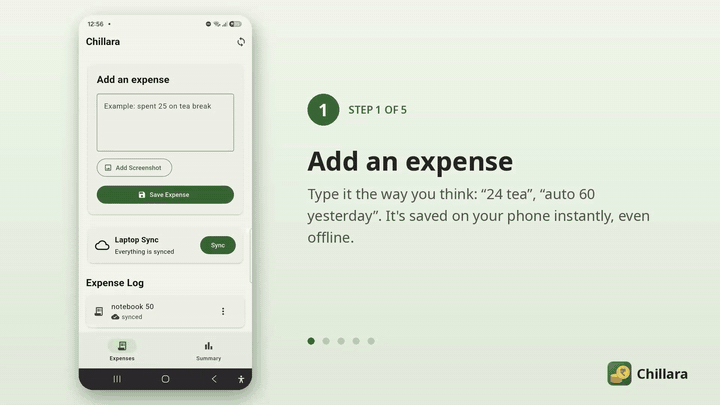
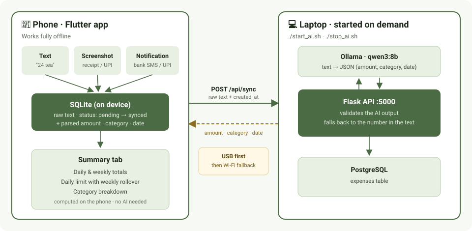

<p align="center"></p>

<h1 align="center">Chillara</h1>

<p align="center"><i>chillara</i> (Malayalam) — small change. A private, offline-first expense tracker for everyday spends.</p>

**Log an expense in two seconds, offline, in plain words — let a local AI on your laptop turn it into clean data.**

Type `24 tea`, `petrol 60` or `120 mandi yesterday` on your phone. The app saves it instantly to an on-device database, even with no network. When you sync, a self-hosted LLM (Ollama + `qwen3:8b`) on your laptop extracts the amount, category and date, and stores it in PostgreSQL. Nothing goes to the cloud.

<p align="center">
  
</p>

## Video tour

<p align="center">
  <a href="docs/video/chillara-tour.mp4">
    
  </a>
</p>

<p align="center"><b><a href="docs/video/chillara-tour.mp4">▶ Watch the full 81-second tour (with voice-over)</a></b></p>

The tour walks through the mobile app in five steps:

1. **Add an expense** — type it in plain words and save it, even offline
2. **Sync with your laptop** — the local AI fills in amount, category and date
3. **Change the laptop address** — long-press **Sync**
4. **See your spending** — daily and weekly totals, categories and history
5. **Set a daily limit** — see how much you can spend today

*Recorded with sample data. Indian English narration generated with Gemini text-to-speech.*

---

## Features

| | |
|---|---|
| ✍️ **Plain-language entry** | Write expenses the way you think: `24 tea`, `Tea24`, `spent 150 on lunch yesterday`. No forms, no dropdowns. |
| 📴 **Offline-first** | Every entry is saved to SQLite on the phone first and synced later. You never lose an entry because the laptop is off. |
| 🤖 **Local AI parsing** | The laptop runs `qwen3:8b` through Ollama to extract **amount**, **category** and **date**, resolving relative dates like "yesterday". |
| 🔌 **USB or Wi-Fi sync** | Sync goes over USB (`adb reverse`) when the phone is plugged in and falls back to Wi-Fi automatically. |
| 📊 **Daily & weekly summary** | Totals for today, this week, the last 7 days and the last 8 weeks, with a category breakdown. Computed on the phone — no AI or network needed. |
| 💰 **Daily limit with rollover** | Set a daily budget and see **how much you can spend today**. Unspent money carries forward through the week; overspending reduces later days. Resets every Monday. |
| 🔔 **Auto-log from notifications** | Optionally reads payment alerts from bank SMS and UPI apps and adds them as expenses (Android). OTPs, credits, refunds and offers are ignored. |
| 🖼️ **Screenshot attachments** | Attach a receipt or payment screenshot to an entry and view it later. |
| 🔒 **Private by design** | Your data stays on your phone and your laptop. No accounts, no cloud services. |

---

## How it works



1. **Capture** — you type an expense (or one arrives from a payment notification). It's written to the phone's SQLite database with status `pending`.
2. **Sync** — tapping **Sync** finds the laptop (USB first, then the saved Wi-Fi address) and sends each pending entry's raw text and timestamp to `POST /api/sync`.
3. **Parse** — Flask asks `qwen3:8b` to return JSON with `amount`, `category`, `description` and `date`. The output is validated; if the model misses the amount, the server falls back to the first number in the text.
4. **Store** — the parsed expense is saved in PostgreSQL and returned to the phone, which keeps the amount, category and date locally and marks the entry `synced`.
5. **Summarise** — the Summary tab reads only the local database, so totals and your daily allowance work anywhere. Unsynced entries are estimated from the first number in their text until they sync.

Failed entries are retried on every sync. If the laptop can't be reached at all, nothing is marked failed — entries simply stay pending.

---

## Tech stack

| Layer | Technology |
|---|---|
| Mobile app | Flutter (Dart), Material 3, `sqflite`, `http`, `image_picker` |
| Android native | Kotlin `NotificationListenerService` + `MethodChannel` |
| Backend | Python, Flask, `flask-cors`, `psycopg` 3 |
| AI | [Ollama](https://ollama.com) running `qwen3:8b` locally |
| Database | SQLite (phone), PostgreSQL (laptop) |

---

## Project structure

```
expense_tracker/
├── lib/
│   ├── main.dart                     # App shell, Expenses tab, sync & address dialog
│   ├── screens/
│   │   └── summary_screen.dart       # Daily/weekly totals, daily limit, categories
│   ├── database/
│   │   └── local_database.dart       # SQLite schema, migrations, settings
│   └── services/
│       ├── sync_service.dart         # USB/Wi-Fi discovery and sync to the laptop
│       └── notification_service.dart # Imports queued payment notifications
├── android/app/src/main/kotlin/.../
│   ├── MainActivity.kt               # MethodChannel for notification access
│   └── ExpenseNotificationListener.kt# Filters and queues payment alerts
├── backend/
│   ├── app.py                        # Flask API + Ollama parsing
│   ├── schema.sql                    # PostgreSQL table
│   ├── requirements.txt
│   └── .env.example
├── docs/images/                      # README images
├── start_ai.sh                       # Start Ollama + Flask on demand
├── stop_ai.sh                        # Stop them again
└── sync_usb.sh                       # Enable USB sync (adb reverse)
```

---

## Getting started

### Prerequisites

- **Laptop:** Linux (the helper scripts use `systemd`), Python 3.11+, PostgreSQL, [Ollama](https://ollama.com/download)
- **Phone:** Android with USB debugging enabled
- **Dev tools:** [Flutter SDK](https://docs.flutter.dev/get-started/install) (Dart ≥ 3.13) and Android SDK platform-tools (`adb`)

A machine that can run an 8B model comfortably (≈ 6 GB of free RAM or VRAM) is recommended. Each entry takes roughly 10–25 seconds to parse on a typical laptop.

### 1. Set up the backend (laptop)

```bash
git clone git@github.com:just-sil/expense_tracker.git
cd expense_tracker/backend

# Python environment
python3 -m venv .venv
.venv/bin/pip install -r requirements.txt

# Database
createdb expense_tracker
cp .env.example .env          # then edit DATABASE_URL
psql "$(grep DATABASE_URL .env | cut -d= -f2-)" -f schema.sql

# AI model
ollama pull qwen3:8b
```

Run it once in the foreground to check everything works:

```bash
.venv/bin/python app.py
curl http://127.0.0.1:5000/api/health    # → {"status": "ok"}
```

### 2. Run the backend on demand (optional)

To start and stop everything with one command instead, install the Flask service once:

```bash
mkdir -p ~/.config/systemd/user
cat > ~/.config/systemd/user/expense-backend.service <<EOF
[Unit]
Description=Expense Tracker Flask backend
After=network-online.target

[Service]
WorkingDirectory=$PWD
ExecStart=$PWD/.venv/bin/python app.py
Environment=PYTHONUNBUFFERED=1
Restart=on-failure

[Install]
WantedBy=default.target
EOF
systemctl --user daemon-reload
```

Then, from the project root:

```bash
./start_ai.sh     # starts Ollama + Flask, waits until ready, enables USB sync
./stop_ai.sh      # stops both and frees the memory used by the model
```

Neither starts automatically at boot. If Ollama's installer enabled it as a boot service, disable that with `sudo systemctl disable --now ollama`.

### 3. Install the app (phone)

```bash
cd expense_tracker
flutter pub get
flutter run            # with the phone connected over USB
```

### 4. Point the app at your laptop

- **USB:** run `./sync_usb.sh` after plugging the phone in (`start_ai.sh` does this for you). The app reaches the laptop at `127.0.0.1:5000`.
- **Wi-Fi:** find your laptop's IP with `hostname -I`, then **long-press the Sync button** in the app and enter it. Port `5000` is used if you leave it out. The app checks the address and tells you whether the laptop answered.

Giving your laptop a fixed IP in your router settings saves you from updating it later.

---

## Using the app

**Add an expense** — type it on the **Expenses** tab and tap **Save Expense**. Any format with a number works:

| You type | Saved as |
|---|---|
| `24 tea` | 24 · Food · Tea · today |
| `petrol 60` | 60 · Transport · Petrol · today |
| `120 mandi yesterday` | 120 · Food · Mandi · yesterday |
| `spent 150 on lunch` | 150 · Food · Lunch · today |

**Sync** — tap **Sync** (or the ↻ icon). Long-press either one to change the laptop address.

**Summary tab**
- **Daily / Weekly** toggle for the current period's total, average, category breakdown and history.
- **Daily limit** — tap *Set a daily limit*. The card shows:
  - **You can spend today** = `limit × days since Monday − spent since Monday`
  - Weekly progress against `7 × limit`
  - An even per-day split of what's left for the rest of the week

  *Example:* limit 300, it's Wednesday, you spent 200 on Monday and 250 on Tuesday → **450** available today.

**Auto-log from notifications** — tap **Enable** on the card on the Expenses tab and allow notification access for *Chillara*. New debit alerts appear in the log the next time you open the app and are parsed on the next sync.

---

## API reference

All endpoints are served by `backend/app.py` on port `5000`.

| Method | Path | Description |
|---|---|---|
| `GET` | `/api/health` | Liveness check → `{"status": "ok"}` |
| `POST` | `/api/sync` | Parse raw text with the AI and store it |
| `GET` | `/api/expenses` | List all stored expenses, newest first |
| `POST` | `/api/expenses` | Add an already-structured expense |

**`POST /api/sync`**

```json
// request
{ "raw_text": "120 mandi yesterday", "created_at": "2026-11-18T12:16:22" }

// 201 response
{
  "success": true,
  "server_id": 21,
  "expense": { "amount": 120.0, "category": "Food", "description": "Mandi", "date": "2026-11-17" }
}
```

Categories: `Food`, `Transport`, `Shopping`, `Bills`, `Entertainment`, `Education`, `Health`, `Other`.

Errors return `{"success": false, "error": "..."}` with `400` (bad input), `503` (Ollama unreachable) or `500`.

---

## Configuration

| Setting | Where | Default |
|---|---|---|
| PostgreSQL connection | `backend/.env` → `DATABASE_URL` | — |
| Flask debug mode | env `FLASK_DEBUG=1` | off |
| AI model | `backend/app.py` → `process_with_ollama` | `qwen3:8b` |
| Laptop Wi-Fi address | in the app: long-press **Sync** | `192.168.0.198:5000` |
| Daily limit | in the app: Summary tab | not set |

> **Security note:** the backend has no authentication and listens on all interfaces so the phone can reach it over Wi-Fi. Run it only on a trusted home network, and keep `FLASK_DEBUG` off.

---

## Troubleshooting

| Problem | Fix |
|---|---|
| Sync says *"Laptop not reachable"* | Run `./start_ai.sh`. Over USB, run `./sync_usb.sh` again after re-plugging. Over Wi-Fi, check the IP with `hostname -I` and long-press **Sync** to update it. |
| Phone shows as `unauthorized` in `adb devices` | Unlock the phone and accept the *Allow USB debugging?* prompt. If it never appears, revoke USB debugging authorizations in Developer options and reconnect. |
| Entries stay `failed` | See the reason with `journalctl --user -u expense-backend -n 50`. Failed entries are retried automatically on the next sync. |
| Wrong amount or category | The AI occasionally misreads unusual phrasing. Putting the number next to the item (`tea 24`, `24 tea`) is the most reliable. |
| Wi-Fi sync is blocked | Allow TCP port `5000` in your firewall, e.g. `sudo firewall-cmd --add-port=5000/tcp --permanent && sudo firewall-cmd --reload`. |

---

## Known limitations

- Screenshot-only entries (no text) are stored on the phone but can't be parsed — the server needs text.
- Deleting an entry on the phone doesn't delete it from PostgreSQL.
- Expenses can't yet be edited after saving; delete and re-add instead.
- Notification auto-logging is Android-only, and its filters are tuned for Indian bank and UPI alerts (₹ / Rs / INR).

---

## Development

```bash
flutter analyze                     # static analysis
flutter build apk --debug           # build an APK
adb install -r build/app/outputs/flutter-apk/app-debug.apk
journalctl --user -u expense-backend -f   # live backend log
```

Local database migrations live in `lib/database/local_database.dart` (`onUpgrade`). Bump the version number and add a migration step when changing the SQLite schema.
